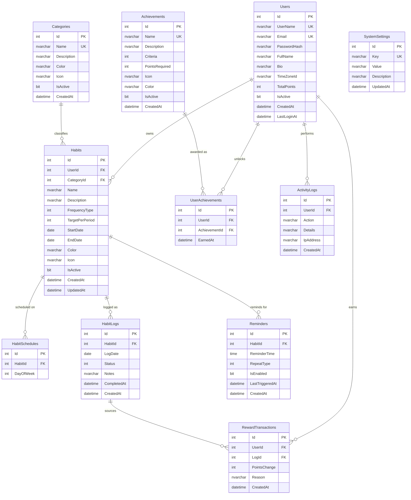

# HTMS — Entity Relationship Diagram

## 1. Diagram (Mermaid)

---

## 2. Relationship Summary

| Parent | Child | Cardinality | Delete behaviour |
|---|---|---|---|
| Users | Habits | 1 : N | Cascade |
| Users | UserAchievements | 1 : N | Cascade |
| Users | RewardTransactions | 1 : N | Cascade |
| Users | ActivityLogs | 1 : N | Cascade |
| Categories | Habits | 1 : N | Restrict |
| Habits | HabitSchedules | 1 : N | Cascade |
| Habits | HabitLogs | 1 : N | Cascade |
| Habits | Reminders | 1 : N | Cascade |
| Achievements | UserAchievements | 1 : N | Cascade |
| HabitLogs | RewardTransactions | 1 : N | SetNull (optional source log) |

---

## 3. Identity Tables

ASP.NET Core Identity contributes six tables, all keyed on `int`:

| Table | Purpose |
|---|---|
| `Users` | User accounts (extended with `ApplicationUser`) |
| `Roles` | Roles: `Administrator`, `User` |
| `UserRoles` | User ↔ role assignments |
| `UserClaims` | Per-user claims |
| `RoleClaims` | Per-role claims |
| `UserLogins` | External login providers |
| `UserTokens` | Tokens (2FA, reset, etc.) |

---

## 4. Key Indexes

| Table | Index | Purpose |
|---|---|---|
| Habits | `(UserId, IsActive)` | Dashboard and list queries |
| Habits | `(UserId, CategoryId)` | Category filtering |
| HabitLogs | `(HabitId, LogDate)` **UNIQUE** | One log per habit per day |
| HabitLogs | `(LogDate)` | Daily tracker and calendar |
| HabitSchedules | `(HabitId, DayOfWeek)` **UNIQUE** | No duplicate weekday rows |
| Reminders | `(HabitId, IsEnabled)` | Due-reminder resolution |
| UserAchievements | `(UserId, AchievementId)` **UNIQUE** | Award an achievement once |
| RewardTransactions | `(UserId, CreatedAt)` | Ledger history |
| ActivityLogs | `(UserId, CreatedAt)` | Audit trail |
| Categories | `Name` **UNIQUE** | No duplicate category names |
| Achievements | `Name` **UNIQUE** | No duplicate achievement names |
| SystemSettings | `Key` **UNIQUE** | Setting lookup |

---

## 5. Business Rules Encoded in the Schema

1. **One log per habit per calendar day** — enforced by the unique index on
   `HabitLogs(HabitId, LogDate)`. Re-completing a habit updates the existing row
   instead of inserting a duplicate.
2. **Points are awarded once per completion** — the completion workflow writes a single
   `RewardTransactions` row per log and updates `Users.TotalPoints` in the same
   transaction; undoing a completion reverses both.
3. **An achievement is unlocked once** — the unique index on
   `UserAchievements(UserId, AchievementId)` guarantees idempotent awarding.
4. **A habit belongs to exactly one user** — `Habits.UserId` is non-nullable with cascade
   delete, so deleting a user removes all of their data.
5. **A category cannot be deleted while habits reference it** — `Restrict` delete behaviour
   forces the administrator to reassign habits first.
6. **Streaks are derived, not stored** — `StreakService` recomputes current streak, longest
   streak, scheduled opportunities and completion rate from `HabitLogs` on demand, so the
   numbers can never drift out of sync with the underlying records.

---

## 6. Streak Rule (specification section 9C)

A streak is a run of consecutive **scheduled opportunities** that were completed.

- A day the habit is **not scheduled** on never breaks a streak.
- A **skipped** or **missed** scheduled opportunity does break it.
- **Today** is still open: an unlogged today neither extends nor breaks the streak.
- `Current` = the run ending at the most recent scheduled opportunity.
- `Longest` = the best run anywhere in the habit's history.
- `CompletionRate` = `Completed / ScheduledOpportunities × 100`, rounded to one decimal.

This rule is covered by 15 unit tests in `tests/HabitTracker.Tests/StreakServiceTests.cs`.
